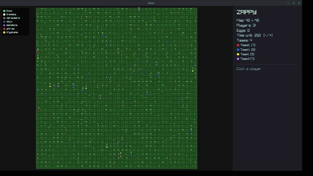
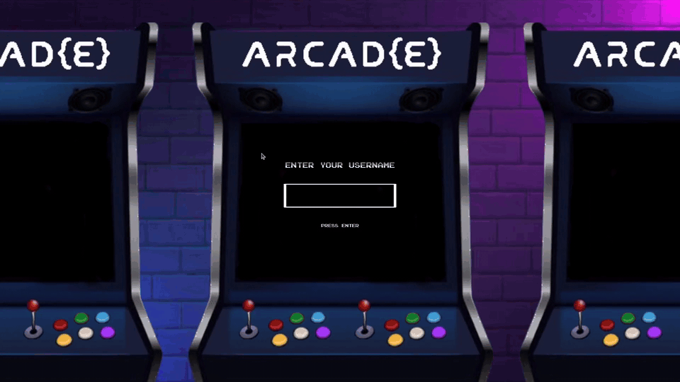
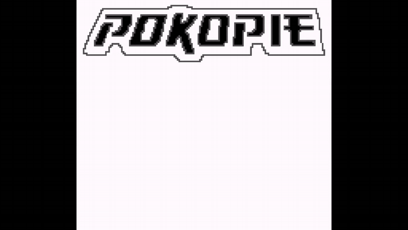
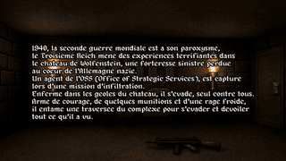
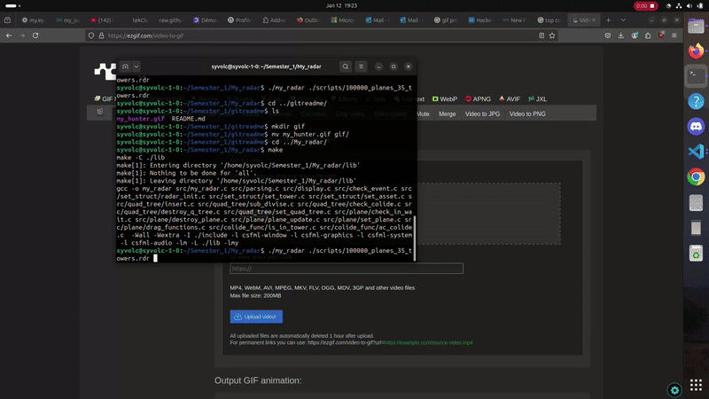
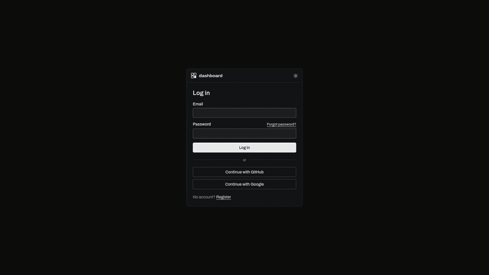

<h1 align="center">Clovis Nedelec</h1>

  3rd-year Epitech student · C / C++ / Rust systems programming, plus React & React Native 
  <b>Open to internship opportunities</b>

  
  

## Skills

  
  
  
  
  
  
  
  
  
  
  
  
  

C · C++ · Rust · Bash · Git · Linux · React · React Native

## Projects

<table>
  <tr>
    <td align="center" width="33%" valign="top">
       
      <b><a href="https://github.com/tekClovis/Zappy">Zappy</a></b> 
      Multiplayer network game: Rust server, Python AI clients, C++ GUI with 3D rendering 
      <code>Rust</code> <code>C++</code> <code>Python</code> <code>sockets</code>
    </td>
    <td align="center" width="33%" valign="top">
       
      <b><a href="https://github.com/tekClovis/ARCADE">Arcade</a></b> 
      Game platform loading games and graphics libs at runtime 
      <code>C++</code> <code>dynamic libs</code>
    </td>
    <td align="center" width="33%" valign="top">
       
      <b><a href="https://github.com/tekClovis/Cartridge">Cartridge</a></b> 
      Game Boy multi-game ROM: 3 games, high scores saved in cartridge RAM + Raycasting 3D engine 
      <code>C</code> <code>GBDK</code>
    </td>
  </tr>
  <tr>
    <td align="center" width="33%" valign="top">
       
      <b><a href="https://github.com/tekClovis/Wolf3D">Wolf3D</a></b> 
      Raycasting 3D engine + Controller playable 
      <code>C</code> <code>CSFML</code>
    </td>
    <td align="center" width="33%" valign="top">
       
      <b><a href="https://github.com/tekClovis/My_radar">My_radar</a></b> 
      Air-traffic simulation with Quadtree optimization 
      <code>C</code> <code>CSFML</code>
    </td>
    <td align="center" width="33%" valign="top">
       
      <b><a href="https://github.com/tekClovis/dashBoard">DashBoard</a></b> 
      Customizable real-time dashboard aggregating GitHub, Steam, YouTube and weather widgets 
      <code>TypeScript</code> <code>Docker</code> <code>OAuth 2.0</code>
    </td>
  </tr>
</table>

## Languages

  
  

